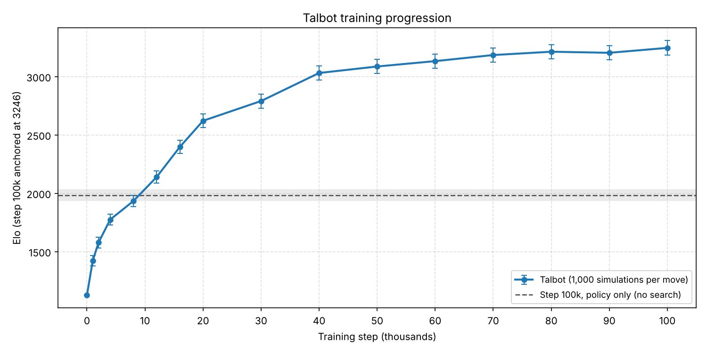

<p align="center"></p>

An AlphaZero-style chess engine and self-play training system, designed for training on a single PC (developed with AI assistance).

- **Play it on [Lichess](https://lichess.org/@/Talbotbot)**
- **Read the [write-up](https://harrisondevane.github.io/talbot/)** 

**Talbot v1.0 plays at an estimated ~3246 ± 14 Elo (CCRL Blitz anchored)**. It was trained tabula rasa from random play in ~96 hours on one RTX 5060 Ti, using no human games and no engine-generated data.

<p align="center">
  
</p>

*Elo of checkpoints from an internal round robin at 1,000 simulations per move, anchored to the final CCRL Blitz estimate. Most of the gain comes in the first ~40k steps.*

## Releases

| Version | Network | Strength | Training | Links |
|---|---|---|---|---|
| v1.0 | 10x128 | ~3246 ± 14 CCRL Blitz (anchored) | ~4.8M games (96 h)| [Weights](https://github.com/HarrisonDevane/talbot/releases/tag/v1.0.0) · [Write-up](https://harrisondevane.github.io/talbot/writeup-v1/) |

To run an older version, clone its tag and use that release's weights.

## How it works

- **Network:** SE-ResNet with WDL value and convolutional policy heads.
- **Self-play:** Gumbel MCTS with sequential halving plus exact handling of proven wins and draws.
- **Training:** C++ self-play engine and Python trainer sharing an LMDB replay buffer. v1.0 trained on ~4.8 million self-play games.
- **Play:** Fully UCI compatible engine using PUCT search.

## Requirements

- NVIDIA GPU with a driver that supports CUDA 13.3 (check with `nvidia-smi`). Developed on an RTX 5060 Ti (16 GB).
- Linux (developed on Ubuntu 26.04).
- Docker with the NVIDIA Container Toolkit.
- Training: 32 GB RAM.

## Quick start

Steps 1–3 run on the host, the rest run inside the container from /app

1. **Clone:**
   ```bash
   git clone --depth 1 https://github.com/HarrisonDevane/talbot.git
   cd talbot
   ```

2. **Build the image** (on the host):
   ```bash
   docker build -t talbot .
   ```

3. **Start a container** (on the host):
   ```bash
   # Play only (UCI, Lichess bot, tournaments)
   docker run -it --gpus all -v "$(pwd)":/app talbot bash

   # Training
   docker run -it --gpus all --shm-size=16gb --cgroupns=host --privileged -v "$(pwd)":/app talbot bash
   ```
   `--privileged --cgroupns=host` lets the trainer create cgroups to enforce its memory limits. Playing doesn't need it.

4. **Compile** (inside the container):
   ```bash
   cmake -S . -B build && cmake --build build -j$(nproc)
   ```

5. **Get the weights:** download the ONNX model from the [v1.0.0 release](https://github.com/HarrisonDevane/talbot/releases/tag/v1.0.0) into `models/`:

   ```bash
   mkdir -p models
   wget -P models https://github.com/HarrisonDevane/talbot/releases/download/v1.0.0/talbot_v1.0_weights.onnx
   ```

6. **Build the TensorRT engine.** Engines are specific to your GPU and driver, so they aren't distributed:

   ```bash
   ./build/talbot_trt_compile models/talbot_v1.0_weights.onnx build/model.engine --input-planes 111 --max-batch 128 --force
   ```

   `talbot_uci` expects `play_uci.yaml`, `model.yaml` and `model.engine` in the same folder (`build/`). These are copied across during cmake.
   
7. **Play:** point any UCI GUI (Cute Chess, Arena, etc.) or fastchess at `build/talbot_uci`.

### Optional downloads

Neither of these is needed for training - self-play starts from the initial position and doesn't use tablebases.

**Syzygy tablebases (3–5 piece, ~1 GB).** Used in play (UCI, Lichess and tournaments) for perfect endgame play.
```bash
mkdir -p data/tablebases/3-4-5 && cd data/tablebases/3-4-5
wget -c -r -np -nd -e robots=off -A '*.rtbw,*.rtbz' http://tablebase.sesse.net/syzygy/3-4-5/
```
Point Talbot at them with the UCI option `SyzygyPath`, or with `syzygy_path` in `config/play_lichess.yaml`.

**Opening book.** Used by the local tournament framework to start games from varied positions. The example configs use `8moves_v3.pgn` from the [official Stockfish books repository](https://github.com/official-stockfish/books). Download it to `data/opening_pgn/` and set its path in the tournament config.

## Training your own

```bash
python python/main_train.py --config config/train.yaml --model_config config/model.yaml
```

The training and model configuration for each release are available in the tagged commit. Note: the core configuration and RAM allocation are hardcoded, and depend on the machine being used. Modify this to suit your core setup.

### ⚠️ Hardware warning

Training runs your GPU at full power for days at a time. The v1.0 run averaged ~178W (the RTX 5060 Ti's power limit is 180W), for about 96 hours. Make sure your cooling and power supply can handle sustained load, and monitor temperatures. I AM NOT LIABLE FOR DAMAGES, USE AT YOUR OWN RISK.

## Running the Lichess bot

Create a Lichess account (upgraded to BOT), create an API token, export it as an environment variable, and run the Lichess script:
```bash
export LICHESS_API_TOKEN=lip_...
python python/main_lichess.py --config config/play_lichess.yaml
```

## Running a local tournament

This repository provides a framework for running internal tournaments using different model sizes and different UCI configurations, allowing round-robin and gauntlet style tournaments - useful for ablations and determining optimal configuration settings. Two example configuration files have been provided, which can be run with:

```bash
python python/main_local_tournament.py --config config/play_local_tournament_players.yaml
python python/main_local_tournament.py --config config/play_local_tournament_sweep.yaml
```

The first line demonstrates an internal round-robin tournament against different model checkpoints across a single run, to show strength changes across training. The second line shows a gauntlet across different search depths, and different PUCT parameters, which is useful for determining optimal search parameter configurations during inference.

## Repository layout

```
src/      C++ self-play engine, MCTS, inference batcher, UCI, tournament
python/   trainer, orchestrator, model, Lichess scripts
config/   training, UCI, tournament and Lichess configs
docs/     write-up
```