# Talbot v1.0 Technical Write-up

## Introduction

Talbot is a chess engine trained entirely from self-play (tabula rasa) on a single machine with one consumer GPU, an NVIDIA RTX 5060 Ti. The aim was efficiency, to find how strong an AlphaZero-style engine can get when every part of the pipeline is built to make the most of limited hardware.

The system has two long-running processes. A C++ self-play engine generates games using Gumbel MCTS at 128 simulations per move, and a Python trainer learns from them. They communicate through a shared LMDB database. Self-play inference runs through TensorRT behind a pipelined batcher that keeps the GPU close to fully used. The search adds exact handling of proven wins and draws, and training targets and move sampling are adjusted for the low simulation budget.

The final 10×128 network trained for 95.8 hours, over roughly 4.8 million self-play games. In a 1000-game gauntlet against ten CCRL-rated engines, it scored an estimated 3246 ± 14 Elo on the CCRL Blitz scale, with network evaluation on the RTX 5060 Ti. This is an estimate under my hardware and time control, not an official rating. Total self-play compute was about 2×10¹⁹ operations, which is ~400~ less than AlphaZero, and ~3.5-4× less than the nearest published single-machine run I found, which used eight GPUs. Strengths are measured on different scales, so this comparison is approximate.

Talbot is primarily an engineering project. Some components, such as target shrinkage, were chosen based on observations from early runs and were not ablated. Results reflect the system as a whole, not the contribution of any single change.

The write-up covers the system architecture and resource management first, then the network, search, action selection and training targets. It ends with evaluation, a discussion of tactical blind spots in self-play, a comparison with existing work, and future work.

## System

### System Architecture

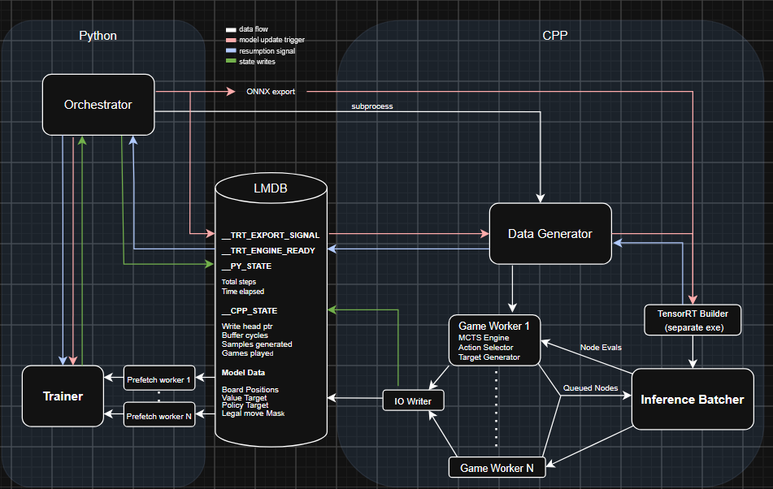

*Figure 1. System architecture: the C++ self-play engine and Python trainer, communicating through a shared LMDB.*

Talbot is a single-machine reinforcement learning system built around two long-running processes: a C++ self-play engine and a Python trainer, communicating through a shared Lightning Memory-Mapped Database (LMDB). Self-play writes positions to the database, and the trainer reads them out for training. Control signals for model updates pass through the same database. A third, short-lived C++ process, the TensorRT Builder, is launched once per model update to compile the new network.

#### C++ self-play engine

The self-play engine has four primary components:

- **Data Generator**. Owns the pool of game workers.

- **Game Workers**. Each worker plays one game at a time. Workers are pinned to cores, with the option to pin multiple workers per core. Each worker owns three subcomponents:

    - The MCTS Engine holds the search tree, the node pool, and the worker's connection to the inference pipeline.

    - The Action Selector applies a move selection hierarchy on the finished search tree.

    - The Target Generator constructs the policy and value training targets from the search results before the move is played.

- **Inference Batcher**. Collects position evaluation requests from all workers through a single shared lock-free queue, groups them into GPU batches, and returns each result to the worker's result queue.

- **IO Writer**. Receives finished games from workers through a separate queue, buffers them in memory, and writes compressed positions to the LMDB in fixed-size batches.

#### Python trainer

The Orchestrator, a Python script, launches the C++ engine as a subprocess, sets up the Trainer, and runs the training loop. The Trainer owns the model and the optimiser. Prefetch workers on dedicated cores read positions from the LMDB and assemble batches for training.

#### Model updates

The model used for data generation is replaced at a fixed training-step interval rather than continuously hot-swapped. During each update, both processes stop, the new network is compiled and loaded, and both resume. In detail:

1.  Halt. The Orchestrator pauses the Trainer and increments \_\_TRT_HALT_SIGNAL.

2.  Drain. On seeing the halt signal, the C++ engine signals the Inference Batcher to pause. The Batcher stops accepting new batches and finishes those already in flight. Game workers then stall waiting for results, so self-play stops without the workers being paused explicitly.

3.  Export. The Orchestrator exports the model to ONNX and sets \_\_TRT_EXPORT_SIGNAL in the LMDB.

4.  Build. The C++ engine sees the signal and launches the TensorRT Builder. The Builder compiles the new engine and writes it to disk.

5.  Reload. The C++ engine reads the finished engine from disk and hands it to the Inference Batcher. The Batcher loads it and resumes, and self-play continues.

6.  Resume. The C++ engine writes the export count to \_\_TRT_ENGINE_READY. The Orchestrator sees it and resumes training.

On startup, if the export count exceeds the ready step, the C++ engine builds the engine before starting any workers.

For Talbot, the update interval was set to 1000 training steps. The pipeline drains in under 10 ms, and a persisted TensorRT timing cache keeps rebuilds short: each update pauses self-play for roughly 15-30 s depending on network size. This represents under 1% of total run time.

#### Persistence

Training progress (\_\_PY_STATE), self-play progress (\_\_CPP_STATE) and the replay buffer all live in the LMDB. Model checkpoints are saved to disk alongside it. A run can be stopped and resumed at any point. Only games in progress and positions not yet flushed by the IO Writer are lost.

### System Specifications

Hardware:

- CPU: AMD Ryzen 9 5950X

- Memory: 32 GB DDR4-3200

- GPU: NVIDIA GeForce RTX 5060 Ti (16 GB VRAM, driver 615.71.09)

- Storage: 256 GB Intel NVMe SSD (OS), 512 GB Samsung 960 EVO NVMe SSD (training data, LMDB, checkpoints).

- OS: Ubuntu 26.04 (kernel 7.0.0-30-generic).

Core software stack:

- CUDA 13.3 (V13.3.73)

- cuDNN 9.24.0

- TensorRT 11.3.0

- LibTorch 2.14.0 (cu132)

- LMDB 2.3.0

- Python 3.14.4

### Inference Batcher

The Inference Batcher is the only self-play component that interacts with the GPU. Self-play workers each produce a small number of position evaluations, but a GPU is efficient only at large batch sizes. The batcher gathers requests from all workers into large batches, runs them through TensorRT, and returns each result to the worker that requested evaluation.

#### Request path

Workers exchange data with the batcher through pre-allocated shared buffers, rather than queues containing full board data:

- A worker claims a free buffer slot, writes its encoded position into it in FP16, and pushes a worker ID, slot pair onto the lock-free queue shared by all workers.

- When the result is ready, the batcher writes the policy and value outputs back into the same slot. It then notifies the worker through that worker's own result queue, sending one message per batch that lists all of the worker's completed slots.

- The number of buffer slots caps how many requests can be outstanding. When the pool runs out, workers wait for a slot, which gives natural backpressure.

#### Pipeline

Inside the batcher, three threads work through three batch slots in rotation. Each slot has its own CUDA stream and its own TensorRT execution context:

- **Filler** takes requests off the shared queue and copies their positions into host memory.

- **Dispatcher** queues all of the batch's GPU work on that slot's stream asynchronously.

- **Collector** waits for a slot's stream to finish and sends the results to the workers.

Because each slot has its own stream and context, up to three batches can be in progress at once. One can be filling, while two are on the GPU, so CPU and GPU transfers overlap with inference. All three threads run on dedicated cores and busy-wait rather than sleeping, minimising wake-up latency.

A batch is sent when it's full, or when no new requests arrive within a timeout. Before inference, the batch is zero-padded up to the next fixed size step, limiting the engine to a few distinct batch shapes.

When a model update begins, the Filler stops starting new batches, and the batcher counts itself paused once every slot is free and nothing is waiting to be dispatched. Once the new engine is built, the batcher synchronises the GPU, destroys the old engine and its execution contexts, loads the new engine, creates three new contexts and resumes.

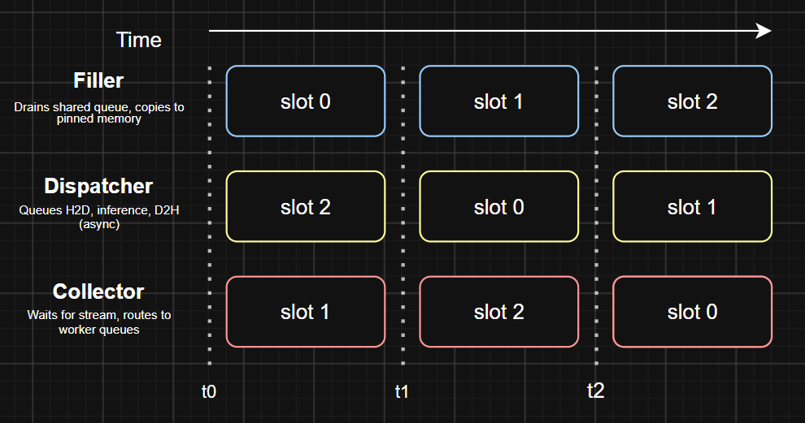

*Figure 2. Inference Batcher pipeline: Filler, Dispatcher and Collector threads rotating through three batch slots.*

For all runs, each worker submitted evaluations in groups of four, with a batch size of 128. Batch sizes were compared by measured self-play throughput, and 128 performed best for all network sizes tested. Because outstanding requests far exceed one batch, every batch fills immediately: across all network sizes, batches are consistently full and the Filler is almost never idle. The 10 ms timeout and the padding to multiples of 64 therefore matter only when demand is low, as at the start of a run.

### Resource Management

#### Memory Allocation

The trainer and the self-play engine each run in their own cgroup. Each group has a soft limit (memory high), above which the kernel reclaims the group's memory, and a hard limit (memory max). The Orchestrator launches the C++ engine into its group, so the TensorRT Builder, as a child process of the engine, runs under the same limits.

The two processes use memory differently:

- Self-play memory is mostly fixed. Node and edge pools are pre-allocated per worker per move, so usage stays flat apart from spikes during engine rebuilds.

- The trainer's process memory is also fixed (model, optimiser state and prefetch buffers), but it reads the replay buffer through LMDB's memory map. Its page cache therefore grows as more of the buffer is read. Once the buffer is larger than the trainer's limit, the kernel evicts cached pages to stay under the limit, and further reads go to disk.

For all runs, the soft and hard limits were 12 GB and 16 GB for the trainer, and 6 GB and 8 GB for self-play, on a 32 GB machine.

#### CPU Allocation

Every component is pinned to its own set of CPU cores, so no two components compete for the same core:

- Game workers are spread across a dedicated block of cores. Several workers can share one core.

- The Inference Batcher's three threads get their own cores, shared out round-robin among the Filler, Dispatcher and Collector.

- The IO Writer and the C++ main thread each get their own cores.

- The trainer is pinned to its own cores once it has launched the C++ engine. The prefetch workers run on separate dedicated cores.

## Methods

### Model Architecture

The network is a residual network (ResNet) [6] with Squeeze-and-Excitation (SE) [7] - the same family AlphaZero and early Leela used. Modern Leela uses transformers, which are stronger but more expensive to train and evaluate. Given the focus on self-play throughput on one machine, Talbot uses a ResNet.

#### Input Planes

The input follows the AlphaZero layout. It contains 111 input planes encoding the current position and 7 previous plies. Each position contains 12 piece planes, a repetition flag, followed by seven planes of metadata for the current position. Everything is encoded from the side to move's perspective. Talbot differs from AlphaZero in three ways:

- It uses one repetition plane per position rather than two. This is because search labels a twofold repetition as a draw, so the network only needs to know whether a position has occurred before.

- It has an en passant plane, with the whole file filled, in place of the move-count plane.

- Missing history at the start of a game is left as zeros rather than padded.

The board is flipped vertically so the side to move's pieces are always on the same edge. Files are never mirrored, so the kingside is on the right for both colours.

#### Residual Stack

A 3x3 convolution projects the input to the network's channel width, followed by a stack of residual blocks. Each block applies two 3x3 convolutions with batch norm, then a Leela-style SE layer before the skip connection:

- The block's output is averaged to one value per channel.

- That passes through a small two-layer MLP.

- The result is split into a per-channel scale (sigmoid) and a per-channel bias, applied as out times scale plus bias.

Classic SE only rescales channels. The added bias lets each block shift its activations based on the whole board, which gives cheap global context without attention.

#### Output Heads

The network has two output heads: a policy head and a value head:

- The policy head is fully convolutional. A 3x3 convolution at full width is followed by a second 3x3 convolution down to 73 planes, one per move type in the AlphaZero encoding. Flattening the 73x8x8 output gives the 4,672 move logits directly, indexed by from-square and move type, with no fully connected layer. Illegal moves are masked before the softmax in the loss and in search.

- The value head reduces the backbone with a 1x1 convolution, then uses two fully connected layers to produce a softmax over win, draw and loss (WDL). WDL lets the network tell a dead-drawn position from a sharp, balanced one, which a scalar value of 0 cannot. This categorical output provides a richer learning signal, and also makes contempt possible during inference.

#### INT8 Quantisation

Self-play inference runs in INT8, apart from the final policy convolution and the value head.

- At each model update, the exported network goes through static post-training quantisation. Weights and activations are quantised symmetrically, with per-channel scales for the weights.
- Activation ranges are calibrated with MinMax on one training batch (4,096 positions) sampled from the replay buffer. Calibration reruns at every update, so the ranges follow the network as it trains, and it runs inside the update pause. MinMax was chosen because it is the fastest of the methods tried.
- The final policy convolution and the whole value head are excluded from quantisation, because their outputs feed search and the training targets directly. The network is exported with FP32 internals for the quantiser, so these excluded layers run in FP32. Input and output are FP16.
- The initial random network is exported in FP16, since there are no positions to calibrate on yet. The first rebuild comes after only a few training steps, so self-play switches to INT8 almost immediately.

The speed and strength effects of INT8 are measured in [Ablations: INT8 inference](#int8-inference).

### Tree Search

Before every move in a self-play game, the engine runs a full Monte Carlo Tree Search (MCTS). MCTS builds a search tree rooted at the current position, using the neural network to evaluate leaf nodes and guide exploration towards promising lines. Once the search finishes, each child of the root carries visit counts, Q values, Gumbel scores and proven-outcome information. The tree is passed to the Action Selector to choose a move, and to the Target Generator to build the policy training target.

#### Gumbel MCTS

AlphaZero selects nodes with PUCT, a UCB-style formula that balances exploiting high-value nodes against exploring high-prior nodes. PUCT works well with a large simulation budget. With few simulations, though, its visit-count statistics are noisy, and it offers no guarantee of improving on the network's own policy. For a single-machine engine with a small budget per move, that is a real limitation. The engine instead uses Gumbel MCTS [2] which guarantees policy improvement with respect to its value estimates even at very low simulation counts.

#### Root selection

Each search starts by evaluating the root, which gives the prior logits and a WDL estimate for the position. Every legal move is then checked for a terminal state. Gumbel noise is sampled and added directly to the raw prior logits, and the top *m* non-terminal moves by this noisy score become the candidates. AlphaZero instead applies Dirichlet noise to the prior probabilities after the softmax. Because the noise is added to the logits, low-prior moves occasionally make the candidate set, which keeps self-play exploring.

#### Sequential halving

The simulation budget is split into log₂(*m*) phases:

- In each phase, simulations go round-robin across the surviving candidates.

- At the end of each phase, Gumbel scores are recomputed using the accumulated Q values, and the bottom half of the candidates is eliminated.

- In the final phase, the budget goes to the last two candidates, and the one with the higher Gumbel score is selected.

#### Selection below the root

Inside the tree, the engine uses a deficit-based selection rule. At each node, every child gets a score: its raw policy logit plus a Q term scaled by a visit-count-dependent σ. A softmax over these scores gives each child a target share of the visits, and the engine descends into the child whose actual share falls furthest below its target. This steers the search towards children that are under-visited relative to their scores. Children with proven outcomes, or that are otherwise unavailable, are skipped.

For all runs, self-play used 128 simulations per move with *m* = 16 candidates, giving four phases of 32 simulations each.

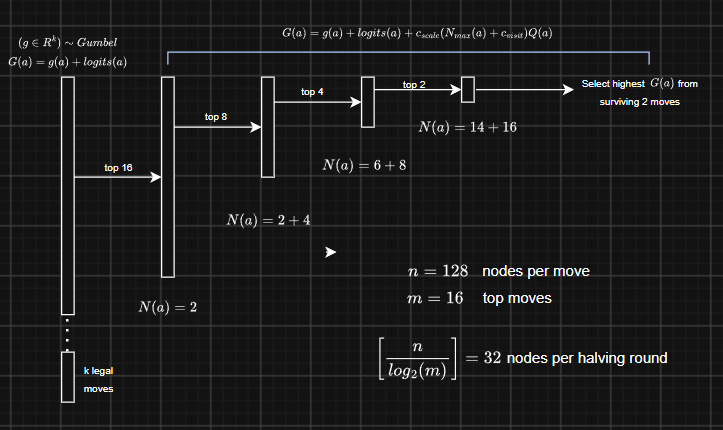

*Figure 3. Gumbel MCTS with sequential halving: 128 simulations, m = 16 candidates, four phases.*

### Proven Outcomes

Pure visit-averaged MCTS handles exact results badly. Suppose one child of a node is a forced win, but its siblings average out negative on network evaluations. The parent's visit-weighted Q is dragged down by the losing lines, even though the mover would simply play the winning move and never enter them. Selection based on averaged Q therefore undervalues the winning line. Draws have the same problem: a single drawn result found deep in the tree is averaged away among network estimates. The engine handles exact results with two mechanisms on top of standard MCTS: minimax proof propagation and mover-has-draw.

#### Terminal Nodes

Checkmate, stalemate, the 50-move rule and repetition are recognised as soon as they're reached. Search scores a twofold repetition as a draw. A terminal node gets an exact outcome immediately and is marked unavailable. It's visited only once, because its value is exact and there's nothing to learn from evaluating it again. Non-terminal nodes, by contrast, only become proven when search proves their subtree, through the rules below.

#### Minimax Proof Propagation

Each node carries a forced outcome flag (unset, win, loss or draw), along with distance to mate for proven wins and losses. A minimax pass at every backpropagation step updates the flag using the following rules, in strict priority order:

1.  **Forced win.** If any child is a proven loss for its own mover, meaning a proven win for the parent's mover, the node is a forced win. Distance-to-mate is the minimum over winning children plus one: the mover picks the fastest mate.

2.  **Forced loss.** If every child is a forced win for its own mover, so every move loses, the node is a forced loss. Distance-to-mate is the maximum over the children plus one: the mover delays mate as long as possible.

3.  **Forced draw.** If all children are proven, none wins, and at least one is a proven draw, the node is a forced draw. The mover takes the draw over any losing alternative.

4.  **Unresolved.** If any child is unproven, the node stays unresolved, and its value falls back to the visit-averaged Q.

A forced win takes priority, since a winning move dominates whatever else is available. Once a node is proven, the flag is treated as final and later passes skip it. A newly proven node can in turn prove its parent. It's also marked unavailable, and that propagates upwards through the availability counters, so selection stops entering proven subtrees. The value function expected value respects the flags: proven wins return +1, proven losses −1 and proven draws 0, replacing the averaged Q.

#### Mover-Has-Draw (MHD)

Minimax proves a draw only once a subtree is fully explored, which in practice rarely happens within one search outside simple endgames. Most drawn lines are found at a single leaf, such as a repetition, 50-move draw or stalemate, inside a subtree whose other branches are unresolved. Under visit-averaging, that leaf adds one visit's worth of 0.0 to its ancestors' Q, and the signal is diluted by the network estimates around it. Revisiting the drawn leaf repeatedly to build up its weight doesn't work either. When the drawn leaf is the only option not already waiting on inference, search re-simulates it over and over without ever going to the GPU, which corrupts the search.

Instead, every node carries a mover-has-draw flag, set during backpropagation by either of two rules:

1.  **Principal-variation rule.** The node's best child by Q, from the mover's perspective, is a proven draw or itself has mover-has-draw set. The flag therefore climbs the current best line: if the mover currently prefers a line that leads to a draw, the node is marked.

2.  **No-escape rule.** Every child the mover might actually play, meaning every child not proven lost, is a proven draw or has mover-has-draw set. The mover can do no better than a draw here, whatever the Q values say.

Both rules are re-evaluated on every backpropagation, so the flag is not monotonic. It clears if the best line moves away from the draw, and can be set late when the no-escape rule finally applies. Expected value returns exactly 0.0 for a flagged node. Selection, target generation, principal-variation extraction and every other consumer of Q inherit this automatically, so ancestors see the drawn line's value immediately, after a single backpropagation.

The two mechanisms cover different stages of a search. Mover-has-draw responds as soon as one drawn leaf is found, and minimax takes over once a subtree is fully proven. The trade-off is that mover-has-draw depends on Q through the principal-variation rule, so it can flip back and forth when sibling Q values sit close to 0. That reflects genuine uncertainty about whether the draw is the best line, but it means the flag is a search heuristic (not a proof). Code that needs certainty reads forced outcome; code that wants the best available value reads expected value, which combines both.

#### Interaction with Sequential Halving

When a root candidate becomes proven during a phase, it's removed from the candidate set immediately, and the rest of that phase's simulations are shared among the survivors. Proven candidates are also removed before each halving step. As a result, visit counts across root children end up uneven, which is not the clean pattern sequential halving produces in the ideal case. The Action Selector accounts for this, since it doesn't choose moves on visit counts alone.

### Implementation

#### Search Lifecycle

Each game worker owns one persistent MCTS engine. At the start of every move, the engine resets: the node pool is rewound, the root is reallocated, and any in-flight inference requests are drained. Trees are not reused between moves during self-play.

#### Board State

Each worker keeps a single board for its whole lifetime. Positions aren't copied into nodes. Instead, the engine makes moves on the board as it descends the tree and unmakes them on the way back up. The history planes for the network input are rebuilt by walking back along the current simulation path, rather than stored with each node.

#### Node/Edge Split

A full search node holds visit counts, WDL sums, cached Q, proof flags, distance-to-mate, availability counters, mover-has-draw, virtual loss and a parent pointer, which comes to 56 bytes. If every legal move got a full node on expansion, most of that memory would go to moves that are never visited. The engine therefore splits the data into two types:

- An edge (24 bytes) holds the move, its prior logit and a pointer to its child node, which starts out null.

- A node (56 bytes) holds the search state. It is allocated only when selection first goes down that edge.

Expanding a position allocates one contiguous block of edges and no nodes. An unvisited move costs 24 bytes; a visited one costs 80. Nodes and edges live in separate pre-allocated arrays, each managed by a per-worker bump allocator. Because most moves are never visited, edges far outnumber nodes, and the tree takes a fraction of the memory a node-per-move layout would. This matters at inference time, when longer searches and several concurrent games all have to fit in system RAM.

#### Virtual Loss

Each worker selects a mini-batch of leaves before any of their results return. Without a correction, the deterministic selection rule would pick the same path every time within a mini-batch. So when a leaf is queued for inference, a virtual loss is applied along its path to the root. That makes the path look temporarily worse, and the next selections go elsewhere. When the result arrives, the virtual loss is removed before the real value is backpropagated.

For all runs, workers submitted mini-batches of four leaves, with a virtual loss of 0.3. During tournament play, workers submit mini-batches of 128.

### Action Selection

Once the search completes, the populated tree is passed to the Action Selector. Moves are chosen by a strict priority hierarchy: proven and draw cases are handled first, and only if none applies does the selector fall through to sampling.

1.  **Forced win.** If any child is a proven win, play the shortest mate. Ties are broken randomly.

2.  **Forced draw.** If a proven draw is available and the best unproven move's Q is at or below the draw cutoff of 0.0, take the draw.

3.  **Mover-has-draw.** If a child carries the mover-has-draw flag, compare the most-visited flagged move against the best unproven move. If both have enough visits relative to the leader, value decides: play the draw if the best unproven Q is at or below the draw cutoff. If only one has enough visit support, play that one. If no unproven alternative exists, play the draw.

4.  **Resignation.** If resignation is enabled for this game, an unproven move exists, and the best Q is below −0.80, resign.

5.  **Sampling or deterministic play.** If unproven moves exist, then for the first 30 plies, sample a move by visit count, filtered by Q (below). After ply 30, play deterministically.

6.  **Delay mate.** If no unproven move is left and every remaining move is a proven loss, play the move with the longest distance to mate.

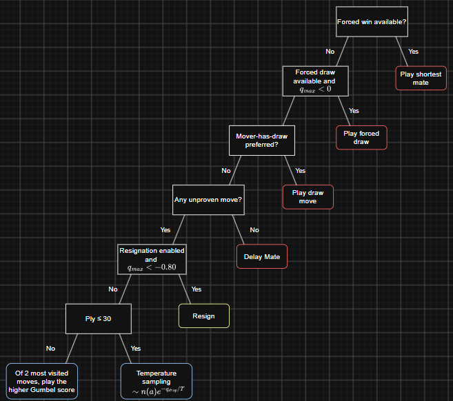

*Figure 4. Action selection priority hierarchy.*

The forced-win rule plays the shortest available mate rather than any winning move. The draw rules apply only when a draw is genuinely the best option: if the engine is winning, an available draw doesn't trigger them. Mover-has-draw also requires visit support, so a lightly searched flag can't override a well-searched alternative. Moves flagged mover-has-draw are never chosen by sampling. Resignation is enabled at random per game: 90% of self-play games allow it, and 10% play losing positions out to mate, so the network still sees what a lost position looks like all the way to the end. Resignation also never triggers in a proven loss; those games are played out to mate.

#### Non-Deterministic Selection

For positions that reach rule 5, how the move is chosen matters a great deal for training. The Gumbel MuZero paper [2] presents Gumbel noise as providing enough exploration on its own. Its ablations, however, note that "during training, MuZero and Gumbel MuZero benefit from explorative acting proportional to the visit counts," which is in tension with that. The paper does not describe how to act during training to get enough diversity, so the mechanism here was arrived at empirically.

##### What Didn't Work

The most natural reading of the paper is to play the argmax of the root Gumbel score after search. With the c_visit and c_scale values from DeepMind's settings (50.0 and 1.0 respectively), the Q term in the Gumbel score is large relative to the noise. The noise is effectively swamped by the prior and the Q signal, so once the network prefers a move, it is selected game after game. In early runs this appeared to overfit the network to a narrow set of opening lines within tens of thousands of games. A later ablation in the final system (see Ablations) found a milder version of the same effect - argmax selection does not fully collapse, but it concentrates the opening heavily.

Sampling directly from the Gumbel scores as a probability distribution also failed. Because the score includes the raw prior logits, high-prior moves are selected more often, receive more visits and produce stronger policy targets. That raises their logits, which raises their Gumbel scores in turn. This feedback loop is most damaging in the opening, where the network is most prone to overfitting. Applying a temperature to the Gumbel scores before the softmax flattens the distribution but doesn't remove the problem, because the prior is still built into the scores.

The fix the paper implies, sampling in proportion to visit counts, doesn't solve the core problem either. Sequential halving produces the same visit distribution however confident the search actually is. The budget is split across log₂(m) phases, and candidates accumulate visits according to the halving schedule, not according to how much better one move is than another. In a position where one move is clearly winning and every other is a blunder, the two candidates that survive halving have identical visit counts and are sampled with equal probability. The visit distribution itself carries no confidence signal.

##### What Worked

The final mechanism samples from a visit-count distribution filtered by a lower-confidence-bound (LCB) Q value. Visit counts are the base weight rather than Gumbel scores, because they're independent of the prior, therefore a move accumulates visits based on what the search actually found instead of what the network initially thought. Only unproven, unflagged children with at least one visit are eligible. Each move's weight is:

$$
w(a) = N(a)\,\exp\!\left(-\frac{q_{\text{drop}}(a)}{T}\right)
$$

where q_drop(a) = max over b of q̃(b), minus q̃(a), which is never negative, and q̃ is a confidence-adjusted value rather than the raw Q:

$$
\tilde{q}(a) = Q(a) - \frac{\sigma(a)}{\sqrt{N(a)}}
$$

Q(a) is the child's search value from the mover's perspective. σ(a) is the standard deviation of the search-averaged outcome at that node, with σ² = (p_w + p_l) − (p_w − p_l)², computed from the visit-averaged win and loss shares. The σ/√N term is the standard error the estimate would have if each visit were an independent game outcome drawn from the node’s WDL. Visits are not such samples, so it works as a heuristic confidence penalty. It is large when a move has few visits or a high-variance outcome distribution, and shrinks as evidence accumulates.

##### Why the LCB, Not Raw Q

The weakness of filtering on raw Q is that a barely visited move can carry a Q that is little more than a single network evaluation. If that value looks good, the move survives the filter and gets sampled even though the search never confirmed it. The LCB penalises exactly this case. A move with one or two visits has a large σ/√N correction, so its q̃ sits well below its raw Q, and it has to be visited enough for its confidence interval to tighten before it can compete on value. The filter therefore trusts a move's evaluation in proportion to how well established it is. In early runs, this removed the low-visit sampling errors seen with the raw-Q version. It also combines naturally with the visit-count base weight: a low-visit move is suppressed twice, once by its small visit count and once by its wider LCB penalty.

##### Behaviour Across Positions

Where one move is clearly best and well searched, it has q_drop = 0 and its weight equals its full visit count, while inferior moves have large q_drop values and are suppressed exponentially. Where several continuations are genuinely viable and well explored, their q̃ values are close, the differences in q_drop are small, and sampling stays diverse. In a forced position, such as a recapture, every alternative to the correct move has both a large raw q_drop and a wide confidence penalty. All of them are suppressed, and the forced move is played almost deterministically. T = 0.1 was set empirically as the point that balances these cases: small enough to suppress clearly inferior moves, large enough not to collapse to argmax among genuinely close ones.

#### Temperature Cutoff

Temperature sampling applies only for the first 30 plies. After that, selection is deterministic. With sequential halving, as in self-play, the engine takes the two most-visited unproven moves and plays the one with the higher Gumbel score, which is the halving winner. With PUCT used at inference, it plays the most-visited move, with Q breaking ties. Early-game diversity matters for training data; later in the game, the network should play its best move. The cutoff was tuned during self-play so that most games began with reasonable openings, while some poor opening moves still appeared in the buffer as negative examples.

### Policy and Value Targets

Training targets are generated immediately after each search, before the move is played.

#### Value Target

The value target is standard: the final game result (win, draw or loss) from the side to move's perspective, assigned to every position in the game once the result is known.

Besides checkmate and the rule-based draws, a self-play game can end in three ways:

- **Resignation.** The side to move resigns when its best Q is below the resignation threshold (see Action Selection). The game counts as a loss for that side.

- **Draw adjudication.** After move 40, if the root's draw probability is at least 0.9 for 6 consecutive plies, the game is declared a draw.

- **Ply cap.** Any game reaching 400 plies is declared a draw.

Resignation and draw adjudication are each enabled in 90% of games and disabled in the other 10%. Those games are played out, so the buffer still contains positions from lost and drawn endgames played to their natural conclusion.

#### Policy Target

The policy target is the improved policy from Gumbel MCTS. For every legal root move a, a logit is formed from the network's prior logit plus a σ-scaled completed Q value, and a softmax over these gives the target:

$$
\pi'(a) = \operatorname{softmax}\big(\text{logit}(a) + \sigma(\text{completedQ}(a))\big)
$$

σ is a monotonically increasing scale that grows with the visit count of the most-visited move. Q is rescaled from \[−1, 1\] to \[0, 1\] before scaling. Because completed Q is defined for every move, visited or not, the target covers all legal moves. Unvisited moves still receive a value: they're assigned the baseline v_mix. Self-play uses zero contempt, so the targets carry no draw bias.

##### v_mix

v_mix is the baseline value given to unvisited moves. It blends the node's raw network value with the visit-weighted average Q of its visited children:

$$
v_{\text{mix}} = \frac{q_{\text{raw}} + \sum_i N_i\,Q_i}{1 + \sum_i N_i}
$$

With visit weighting, v_mix is essentially the node's own running search value, with proven and mover-has-draw children counted at their exact values rather than their backed-up averages. The Gumbel paper instead weights the visited children's Q by their prior probabilities. In early runs, prior weighting was less stable, especially in positions where the network's prior was inaccurate. Visit weighting gives more weight to what the search actually found.

##### K-Shrinkage

The second change is to completed Q itself. The paper uses a step function: the empirical q̂(a) for any visited move, and v_mix for unvisited ones. Here, completed Q is instead shrunk towards v_mix according to visit count:

$$
\text{completedQ}(a) = \frac{N(a)\,\hat{q}(a) + k\,v_{\text{mix}}}{N(a) + k}
$$

At zero visits this reduces to v_mix. As N(a) grows, q̂(a) increasingly dominates, and the estimate converges to the paper's. The constant k sets the confidence scale: the visit count at which a move's own value and the v_mix baseline are weighted equally. The paper's construction is a limiting case: as k → 0, visited moves take their full q̂(a), recovering the step function. For all runs, k = 2.

##### What It Does

The completed-Q softmax is sensitive to the Q values of individual root children. A node with a single visit can carry a Q that is little more than one network evaluation, an estimate the search never corroborated. Under the original construction, such a node contributes its full Q to the target. If that value is a confident misevaluation, it shifts the target logit by the full amount, and the policy is taught to move probability towards a move the search didn't validate.

Shrinkage limits this. A poorly explored move contributes only a fraction of its deviation from v_mix, so a noisy single-visit value produces a small shift rather than a full one. The intended effect is less noise in the policy target.

It matters most in a specific and common situation: the search has explored the strong moves thoroughly and found them good, while some barely explored move carries a raw evaluation that looks better. Under the original construction, that under-explored move would pull target mass away from the moves the search actually validated. Under shrinkage it can't, because its low visit count keeps its completed Q close to v_mix. The cost is a slower response to genuinely strong moves discovered late. But a strong move, once its high Q raises its score, is promoted by the search and gathers further visits, at which point shrinkage no longer holds it back. Only moves the search never properly checked stay shrunk.

##### Effect on the Policy-Improvement Guarantee

The paper's improvement result [2, Appendix C] relies on σ being monotonically increasing: adding an increasing function of each move's value to its logit can only raise the expected value under the resulting policy. That holds for whatever completed-Q values are supplied, so it continues to hold under shrinkage. What changes is which values the improvement is measured against.

Shrinkage preserves each move's direction relative to the baseline:

$$
\text{completedQ}(a) - v_{\text{mix}} = \frac{N(a)\,\big(\hat{q}(a) - v_{\text{mix}}\big)}{N(a) + k}
$$

A move the search found better than v_mix is still pushed up, and a worse one is still pushed down; only the size of the deviation shrinks. Shrinkage does not, however, preserve the ordering between moves with different visit counts. A lightly visited move with a high q̂ can rank below a well-visited move with a lower q̂. That is the intended effect, since moves are ranked by value weighted by evidence. It does mean the improvement guarantee holds against these evidence-weighted values, not against the raw search estimates the paper's construction uses. Since shrinkage pulls towards the same v_mix baseline the paper already uses (Appendix D), it introduces no new estimator; it changes how much each move's own estimate is trusted.

#### Proven Outcomes in Targets

Proven outcomes are exact and bypass shrinkage. A proven win enters the completed-Q softmax at Q = +1, a proven loss at Q = −1, and a proven draw at Q = 0. Because σ is large relative to the spread of the logits, a proven loss at −1 is pushed tens of logits below the alternatives and receives effectively zero probability. A move flagged mover-has-draw also enters at Q = 0. That is a search heuristic rather than a proof, but it matches the value search itself assigns to the move.

Passing these outcomes in as fixed Q values, rather than overriding the target directly, gives the network the exact value for proven moves while keeping the policy target a continuous distribution.

### Search at Inference Time

Sequential halving suits the low-budget setting Gumbel MCTS was designed for: a few hundred simulations per move, concentrated on the strongest candidates through explicit elimination. At self-play budgets, that is exactly what's wanted.

In tournament play, the engine gets orders of magnitude more simulations per move, and the phase structure starts to work against it:

- **Stranded visits.** Once a candidate is eliminated, its subtree is frozen. All the visits it received in earlier phases are wasted, and at high budgets this can be a large share of the total.

- **No tree reuse.** Sequential halving plans its whole budget from zero across a fixed candidate set. A subtree carried over from the previous move already has visits from a different schedule, and those don't fit into the new plan.

- **Budget forecasting.** Halving needs the total budget before the search starts. In play, that has to be predicted from measured nodes per second and the time available, both of which vary. If the prediction is too low, the final phases are starved, which distorts move selection.

Four root strategies were compared for play:

- Gumbel sequential halving

- pure deficit-based selection from the root

- PUCT

- a hybrid with sequential halving at the root and PUCT below

PUCT was the strongest. This is consistent with the reasoning for using Gumbel in self-play: PUCT's weakness is at low simulation counts, and at tournament budgets that weakness no longer applies.

At inference time, the engine therefore uses PUCT throughout the tree, with the network's policy passed through a softmax at temperature 1.4 before it is used as the prior. Proven-outcome handling and mover-has-draw are unchanged. The final move is the most-visited root move, with Q breaking ties. Because PUCT has no fixed budget schedule, the tree from the previous move is reused: the subtree under the move actually played becomes the new root.

### Training

#### Loss and Optimiser

The network is trained on two losses with equal weight:

- **Policy loss:** KL divergence between the network's policy and the improved-policy target π′, over legal moves

- **Value loss:** cross-entropy between the network's WDL output and the game result.

Optimisation uses SGD with momentum 0.9 and L2 weight decay of 1e-4 (excluding batchnorm layers), following AlphaZero and Leela. There is no data augmentation. Castling rules break chess's left-right symmetry, so boards can't be mirrored the way Go boards can.

The learning rate follows a fixed step schedule:

- a linear warmup from 0.002 to 0.2 over the first 1,000 steps

- 0.2 from 1,001 to 30,000 steps

- 0.02 from 30,001 to 60,000 steps

- 0.002 for the remainder of the run

Training runs on the same GPU as self-play inference, so the two share the device throughout.

#### Replay Buffer

Positions are sampled uniformly at random from the LMDB replay buffer, in batches of 4,096. Every position in the buffer is equally likely to be chosen, however old it is.

Training starts once the buffer holds 2 million positions. The buffer's capacity then grows linearly to 40 million positions, roughly 500,000 games, over the first 40,000 training steps, and stays there. A small buffer early on lets training cycle quickly through the low-quality games of the first phase, when the network is improving fastest. The large buffer later keeps a wide, diverse window of games as training stabilises. Any given batch draws on a long stretch of training history, covering a range of the network's playing strength.

#### Sampling Ratio

The sampling ratio of 1.0 (one gradient step per 4,096 new positions) is enforced mechanically. The IO Writer flushes positions to LMDB in batches of exactly 4,096, matching the training batch size, and updates the buffer metadata after each flush. The trainer polls this metadata and takes its next step only once 4,096 new positions have been written since its last one. The ratio of positions generated to gradient updates is therefore exactly 1:1.

#### Data Loading

Eight prefetch workers on dedicated CPU cores read positions from LMDB in the background, decode them, and assemble batches ahead of time. Batches are handed to the trainer through shared memory, so reading from the buffer runs in parallel with gradient steps.

## Evaluation

All results for this section pertain to the 10x128 net, labeled as Talbot v1.0

### Elo Methodology

External strength was measured with a 1,000-game gauntlet against ten engines with published CCRL Blitz ratings [8], from 2919 to 3386 (as at 16 November 2026). Each opponent played 100 games, made up of 50 openings drawn from Stockfish's 8moves_v3.pgn [11] with a random seed per opponent, each played once with each colour. Games used the CCRL Blitz time control of 2 minutes plus 1 second, scaled to this CPU with the Stockfish 10 benchmark, giving 65.3 s + 0.54 s. Opponents ran single-threaded, with one full core allocation, and 128 MB hash. Talbot and opponents both had access to 3–5 piece Syzygy tablebases in search.

Games were run with fastchess [10] on the same 5950X used for training, two at a time, with each engine pinned to fixed logical cores. Each Talbot instance searches on one logical core and uses its inference subsystem, three Inference Batcher threads on the same CCD plus the shared RTX 5060 Ti, for network evaluation. Each opponent is pinned to both logical threads of one physical core, so its single thread has a full core to itself, as CCRL assumes. Cores 0–7 are left for the operating system.

The purpose of this setup is to treat the inference subsystem as a hardware extension, giving Talbot one core for the tree search. Talbot searches with GPU evaluation, while the anchor engines run on a single CPU thread. The time-control scaling corrects only for CPU speed, not for the GPU. The result is therefore an estimate anchored to the CCRL Blitz scale under this hardware and time control, not an official CCRL rating, and it would differ on other hardware. Talbot searched at roughly 30–40k nodes per second during the gauntlet.

During the gauntlet, Talbot uses a policy temperature softmax of 1.4, a cpuct of 3.0, and a draw cutoff of 0.2. These were tuned by sweeping each parameter with the final checkpoint in matches against itself, so no gauntlet opponent was used in tuning. The draw cutoff was chosen because Talbot converts winning endgames less reliably than its middlegame strength suggests, so accepting a draw in a slightly favourable position scored better than playing on.

Ratings were fitted with Ordo [9], with each opponent's CCRL Blitz rating held fixed as an anchor. The 95% confidence interval was estimated by Ordo.

### External Benchmark

| Opponent | CCRL | W | D | L | Score | Expected | Diff |
|---|---:|---:|---:|---:|---:|---:|---:|
| Scarlet 2.0 | 3386 | 27 | 41 | 32 | 47.5/100 | 31% | +17 |
| Dual 0.4.3 | 3334 | 15 | 62 | 23 | 46/100 | 38% | +8 |
| Gilipol 2.00 | 3254 | 11 | 74 | 15 | 48/100 | 49% | −1 |
| Svart 6 | 3254 | 15 | 64 | 21 | 47/100 | 49% | −2 |
| Casanchess 2.0 | 3192 | 25 | 55 | 20 | 52.5/100 | 58% | −5 |
| Pingu 5.0.0 | 3180 | 35 | 54 | 11 | 62/100 | 59% | +3 |
| Vault 0.4.1 | 3100 | 41 | 42 | 17 | 62/100 | 70% | −8 |
| tomitank 7.0 | 3045 | 51 | 42 | 7 | 72/100 | 76% | −4 |
| Sentinel 2.0 | 2983 | 63 | 32 | 5 | 79/100 | 82% | −3 |
| zurichess Neuchatel | 2919 | 64 | 30 | 6 | 79/100 | 87% | −8 |
| **Total** |  | **347** | **496** | **157** | **595/1000** |  |  |

*Table 1. Gauntlet results against ten CCRL Blitz-rated engines (100 games each).*

Talbot v1.0 scored 595/1000 (+347 =496 −157), for an anchored rating of 3246 ± 14 Elo (Ordo, 95% CI). This interval treats the anchors' CCRL ratings as exact and assumes one rating fits every opponent, so the true uncertainty is likely substantially larger. Per-opponent results are flatter than a single rating predicts. Talbot v1.0 over-performed against the two strongest engines (Scarlet +17 and Dual +8 points over expectation), matched expectation against engines near its own level (Gilipol −1, Svart −2), and under-performed slightly against weaker ones (as low as −8 against Vault and zurichess). This is consistent with its high draw rate, with 49.6% of games drawn. During evaluation, Talbot v1.0 was configured to play for a draw in slightly favourable positions. Because Talbot ran on a GPU while the anchors are CPU engines, this is a CCRL-anchored estimate under this hardware and time control, not an official CCRL rating.

All 1,000 gauntlet games are available as PGNs in the v1.0.0 GitHub release.

### Lichess

| Time control | Rating | Games |
|---|---:|---:|
| Bullet | 2593 | 16 |
| Blitz | 2564 | 113 |
| Rapid | 2513 | 360 |
| Classical | 2664 | 77 |

*Table 2. Talbot's Lichess bot ratings as of 26 November 2026.*

Talbot also plays as a bot on Lichess (Talbotbot), where anyone can challenge it. On Lichess it runs without the core restrictions used in the gauntlet and can play several games at once. These ratings come from the Lichess bot pool, which differs from CCRL in its opponents, hardware and time controls, so the two scales are not comparable. Lichess bot ratings are also compressed near the top, with the strongest CCRL engines plateauing at around 3000. Talbot plays without an opening book and samples its opening moves for variety and more interesting games. It does use endgame tablebases.

### Internal Progression

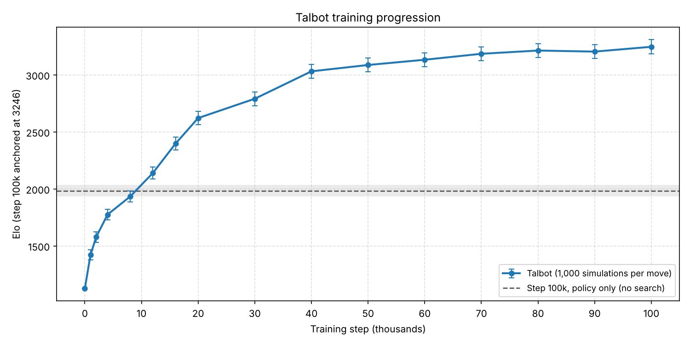

*Figure 5. Training progression: round-robin Elo of checkpoints every 10k steps, anchored to the final CCRL Blitz estimate.*

Figure 5 shows Talbot's training progression from a round robin of checkpoints every 10k steps, plus the final net without search, at 200 games per pairing and 1,000 simulations per move. The final checkpoint is anchored to its CCRL Blitz estimate of 3246. Step 0, the untrained net, appears at about 1740, but that figure is unreliable. With no checkpoints between 0 and 10k, it scored only 2% against much stronger nets, too few points to measure a gap that large. Most of the gain comes by step 40k, and from 70k the curve flattens to within about 50 Elo. Without search, the final net rates about 1,090 Elo lower, similar to step 10k with search. Only the step-100k anchor corresponds to an external rating, since self-play gaps typically overstate differences against other engines.

### Training Metrics

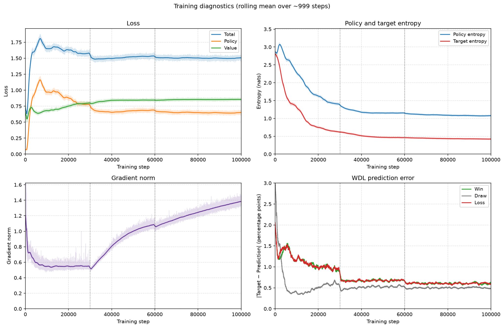

*Figure 6. Training metrics: losses, policy/target entropy, gradient norm and WDL prediction error. Dotted lines mark learning-rate drops at 30k and 60k steps.*

Figure 6 shows four core training metrics, with the two learning rate drops shown as dotted lines at 30k and 60k steps.

- Top left: the value, policy and total loss. At step 0, the untrained net produces largely uniform policy targets, as the untrained value head predicts equal positions. These uniform targets are easy to predict. In each run, after the second rebuild at 1000 steps, the value head begins predicting non-uniform outputs, leading to non-uniform policy targets. Because of these dynamics, it was characteristic for every run that the policy loss would begin low (~0.05), rise to a peak, and begin to decay. The value loss consistently began low, and rose over the course of training. This rise was related to the draw rate during self-play. As the value predicts a categorical WDL output, a rising draw rate - a rough indication of increasing self-play game quality - becomes more challenging to predict.

- Top right: the policy and target entropy: entropy measures how spread out a move distribution is, with $e^H$ giving a rough idea of how many moves it is effectively choosing between. The policy entropy is the spread of the net's own move probabilities (from the raw policy), and the target entropy is the spread of the improved policy produced by search, which the net is trained towards. Both began near 2.8–3.0 nats, close to uniform over the ~30 legal moves in a typical position, and fell over the course of training. By step 100k the policy entropy settled at ~1.07 nats (roughly three effective moves) and the target at ~0.43 (roughly one and a half). The target was always sharper than the policy, as search concentrates probability on the moves it confirms - the gap between the two is a rough indication of how much search adds beyond the prior. Most of the drop happened in the first 20k steps, with a further drop after the first learning rate reduction. The policy never fully matched the target, partly because individual targets carry search noise and the net averages over many similar positions.

- Bottom left: gradient norm: the gradient norm held steady at ~0.55 until the first learning rate drop, then rose steadily to ~1.4. This is expected, and was seen across all runs, as each convolution is followed by batch normalisation, so the network is insensitive to the scale of the convolution weights, and weight decay keeps shrinking them. At a lower learning rate the weights settle at a smaller norm, and the gradient grows in proportion. The losses stayed stable throughout.

- Bottom right: WDL prediction error: this is the gap between the average predicted and average target win, draw and loss percentages in each batch - a measure of how well calibrated the value head is on average, rather than its accuracy on individual positions. The error dropped below one percentage point within the first 20k steps and stepped down at each learning rate drop, finishing at ~0.6 points for wins and losses and ~0.5 for draws.

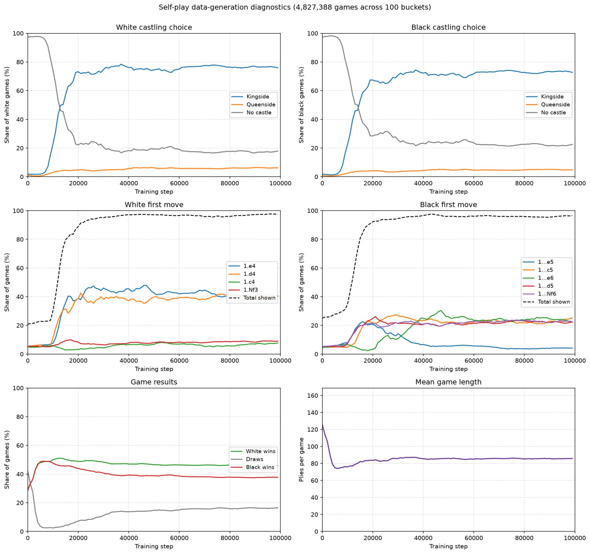

*Figure 7. Self-play game properties: castling rates, most common first ply, game results and mean game length.*

Figure 7 shows properties of the self-play games generated over the course of training.

- Top left and right: the proportion of games showing kingside, queenside and no castling, for white (top left) and black (top right). Castling is a non-trivial feature for a network to learn, as it requires moving at least a knight and bishop, and an understanding that moving the king away from the centre, or bringing a rook towards the centre, is beneficial. Castling is learned for both white and black around 10k steps, and by the end of training white castles slightly more than black, with ~82% of games as white and ~78% of games as black featuring a castling move.

- Middle left and right: the most common first ply for both white and black. At the beginning of training, the final result of a game is poorly correlated with a specific opening move, as the quality of the game is low and blunders decide the final result. At ~10k steps, the self-play games become high quality enough for the opening moves to matter, and the network begins preferring traditional opening moves - e4 and d4 for white - and a range of various responses for black (notably excluding e5). Both white and black moves saturate above 95% - the other 5% provide negative examples, ensuring it does not overfit to specific openings.

- Bottom: the game results (left) and mean game length (right). At the beginning of training, the draw rate is high as the network largely has to stumble into a checkmate, and many games end due to reaching the max ply limit (400). Additionally, an MHD specific quirk of an untrained value head results in many early three-fold repetitions (value noise pushes a result above or below the draw threshold of 0.0). By 10k steps, the games become more decisive resulting in a low draw rate (and lower mean game length seen in the bottom right panel). For the remainder of training, the draw rate slowly grows, and mean game length stabilises around 82 plies. The draw rate was a good proxy for network strength across runs with the same settings, as typically, a high draw rate is indicative of higher quality self-play.

### System Results

#### Comparison across runs

| Network Architecture | Parameter Count | Training time (hours) | Nodes per second | Games per second | CPU usage (%) | Avg GPU power (W) |
|---|---:|---:|---:|---:|---:|---:|
| 6x64 | 889,676 | 44.3 | 331,383 | 29.6 | 24.8 | 139.7 |
| 10x128 | 3,830,028 | 95.8 | 152,719 | 14.0 | 17.3 | 178.0 |
| 15x192 | 11,720,876 | 256.7 | 57,021 | 5.4 | 14.8 | 177.9 |

*Table 3. Comparison of three network sizes trained with the same pipeline and settings.*

Table 3 compares three network sizes trained with the same pipeline and settings. Only the 10x128 net is released as Talbot v1.0. The 6x64 and 15x192 nets are unreleased and are included to show how the system performs at different sizes. Each run generated the same total amount of self-play search, so training time scaled inversely with nodes (network evaluations) per second, and network size affected training time only through inference throughput. The 10x128 and 15x192 runs were clearly GPU-saturated, averaging ~178 W against the card's ~180 W power limit at ~99% utilisation. The 6x64 run averaged only 139.7 W, so with a net that small the bottleneck moved elsewhere in the pipeline.

The 6x64 finished ~305 Elo below the 10x128 run. The 15x192 also finished below it, by ~61 Elo, despite three times the parameters, and showed similar self-play and training diagnostics. The most likely cause is INT8 self-play: at equal nodes, INT8 costs the 15x192 about 89 Elo, against about 19 for the 10x128 (see Ablations: INT8 inference), so its training targets came from a noticeably weaker search than the network could support. This hasn't been tested directly.

## Ablations

### Action selection
The action selection mechanism (LCB-filtered visit sampling) was chosen based on observations from early runs. To test it directly, I trained three 6x64 networks for 40k steps each. The runs were identical apart from how moves were selected in the first 30 plies of self-play:

- **Argmax:** no sampling. Every move is the sequential halving winner, so the only randomness comes from the root Gumbel noise. This is the most natural reading of the Gumbel paper.
- **Visits:** moves sampled in proportion to visit count, with no Q filter.
- **LCB:** the method used for Talbot v1.0, sampling by visit count with exponential suppression by LCB value (T = 0.1).

#### Opening diversity

Diversity was measured on the self-play games generated between steps 39k and 40k of each run. Positions are compared rather than move sequences, so transpositions count as the same opening.

| | Argmax | Visits | LCB |
|---|---:|---:|---:|
| Games | 44,682 | 75,628 | 48,054 |
| Most common first move | 1.d4 (86%) | 1.e4 (20%) | 1.e4 (50%) |
| White first-move entropy (bits) | 0.69 | 3.51 | 1.89 |
| Black first-reply entropy (bits) | 1.69 | 3.62 | 2.52 |
| Most common position, ply 8 | 21.7% | <0.1% | 2.4% |
| Most common position, ply 20 | 12.3% | <0.1% | <0.1% |
| Draw rate | 13.2% | 3.3% | 10.9% |
| Mean game length (plies) | 91.6 | 54.0 | 84.9 |

*Table 4. Self-play diversity at step 39k for the three action selection methods (6x64).*

Argmax selection did not collapse to a single opening as in my early runs, but it concentrated the opening heavily. By step 39k, 86% of games began 1.d4, and 12.3% of all games reached the same position after ten moves, an Exchange Slav line. The distribution was also unstable: the dominant first move switched from 1.e4 (~70% at 25k steps) to 1.d4 (~70% at 35k steps) within about 10k steps. The root Gumbel noise is too weak to override a confident prior, so once the network prefers a line, it is replayed until its value estimates shift.

Visit sampling failed in the other direction. Its openings were highly diverse, but much of that diversity came from weak moves: 1.d3, 1.e3 and 1.Nc3 were among White's most common first moves, and lines featuring early ...a6, ...b5 and ...h6 were common. Games were 36% shorter, the draw rate fell to 3.3%, and 14% of games ended before ply 20. This is the failure described in Methods: sequential halving gives the final candidates similar visit counts regardless of their quality, so blunders are sampled almost as often as good moves.

LCB sampling was diverse without being noisy. White played a mix of 1.e4, 1.d4 and 1.Nf3, Black replied with a range of standard defences, and almost no two games shared a position after ten moves.

#### Strength

The three 40k checkpoints played a round robin at 1,000 simulations per move, with 1,000 games per pairing and each opening played with both colours. It was run twice, from 8-ply and from 16-ply book openings. Ratings were fitted with Ordo, with LCB as the anchor.

| | 8-ply openings | 16-ply openings |
|---|---:|---:|
| LCB | 0 | 0 |
| Argmax | −56 ± 16 | −47 ± 16 |
| Visits | −114 ± 17 | −76 ± 17 |

*Table 5. Round-robin Elo of the three 40k checkpoints, relative to LCB (Ordo, 95% CI).*

LCB was strongest at both opening depths. Its advantage over argmax was ~50 Elo and did not depend on opening depth: even 8-ply openings mostly start outside the argmax network's preferred lines. Visit sampling was weakest, but its deficit fell from 114 to 76 Elo with deeper openings. That is consistent with its main weakness being the opening itself, where its training data was poorest, which deeper book positions partly bypass.

These ablations have some limitations. Each method was trained once, with a single seed, so run-to-run variance is unknown, and smaller differences, such as between argmax and LCB, may partly reflect it. All three runs used the 6x64 network and stopped at 40k steps, well short of a full training run, so it is untested whether the gaps grow, shrink or persist with longer training or a larger network. Strength was measured only against the other ablation networks, not against external engines.

### INT8 inference

Self-play used INT8 TensorRT engines. The residual stack was quantised with post-training static quantisation (per-channel symmetric weights, MinMax calibration on replay-buffer positions).

#### Speed

| Network | Batch | INT8 (pos/s) | FP16 (pos/s) | INT8 vs FP16 |
|---|---:|---:|---:|---:|
| 6x64 | 128 | 439,700 | 520,700 | −16% |
| 6x64 | 256 | 520,500 | 604,500 | −14% |
| 10x128 | 128 | 148,800 | 149,700 | −1% |
| 10x128 | 256 | 160,400 | 155,600 | +3% |
| 15x192 | 128 | 59,800 | 49,000 | +22% |
| 15x192 | 256 | 64,000 | 52,400 | +22% |

*Table 6. INT8 and FP16 inference throughput on the RTX 5060 Ti, measured with trtexec (single stream, GPU compute only). The self-play pipeline runs three batches concurrently, so its sustained throughput can be slightly higher than these figures.*

INT8's benefit depends on network width. It's slower than FP16 at 6x64, about even at 10x128, and 22% faster at 15x192. INT8 speeds up the convolutions but adds a roughly fixed cost from quantise/dequantise steps and memory-bound layers (SE pooling and gating, residual adds). Only wider networks have convolutions large enough to outweigh that cost.

The FP32 heads probably add to that overhead. In a per-layer profile of the 10x128 INT8 engine, `policy_conv2` and `value_fc1` were the two slowest layers, each taking about 5x as long as an INT8 residual convolution. Running them in FP16 might recover some of that time (not tested).

#### Strength

Each network's INT8 engine played its FP16 engine from the same checkpoint: 1,000 games at 1,000 simulations per move from 8moves_v3 openings. Both sides search the same number of nodes, so this measures accuracy loss only, not speed. Elo from Ordo; intervals computed from the W/D/L counts.

| Network | FP16 W / D / L | FP16 score | Elo (FP16 − INT8) | 95% CI |
|---|---|---:|---:|---|
| 10x128 | 381 / 291 / 328 | 52.7% | +18.8 | 0 to +37 |
| 15x192 | 498 / 251 / 251 | 62.4% | +88.9 | +69 to +107 |

*Table 7. INT8 vs FP16 at equal nodes: 1,000 games at 1,000 simulations per move (Ordo; 95% CI from W/D/L counts).*

- **10x128:** INT8 costs about 19 Elo, which is only just significant.
- **15x192:** INT8 costs about 89 Elo, nearly five times as much.

The 15x192 self-play data was generated with the INT8 engine. Whether that hurt the trained network's strength hasn't been tested, but seems plausible. Because INT8 costs the 15x192 network more than the 10x128, the two were also compared with both in FP16: 200 games at 1,000 simulations per move. The 10x128 still won, +95 =47 −58 (59.2%, about +65 Elo, 95% CI roughly +20 to +110), so INT8 inference alone does not explain the gap.

#### Which precision each result used

- **CCRL gauntlet:** INT8 10x128. At equal nodes, the FP16 version of the same network is about 19 Elo stronger. The gauntlet hasn't been rerun with FP16.
- **Internal evaluation matches** (training progression, action selection ablation): INT8.

## Discussion

### Self-play Analysis

The main cost of a 128-simulation search combined with deficit-based non-root selection is occasional tactical oversights in self-play. Sequential halving forces breadth only at the root, and further down the tree, visits follow the prior. With the combination of n=128 and m=16, principal variation moves receive only 30 visits each. Due to this limited visit count, and the deficit-based non-root selection, visit allocation closely follows the prior below the root. When a refutation has a low prior from the opponent's side, the opponent's search gives it too few visits to find. The following examples are taken from Talbot self-play games:

#### Example 1: Pins

| 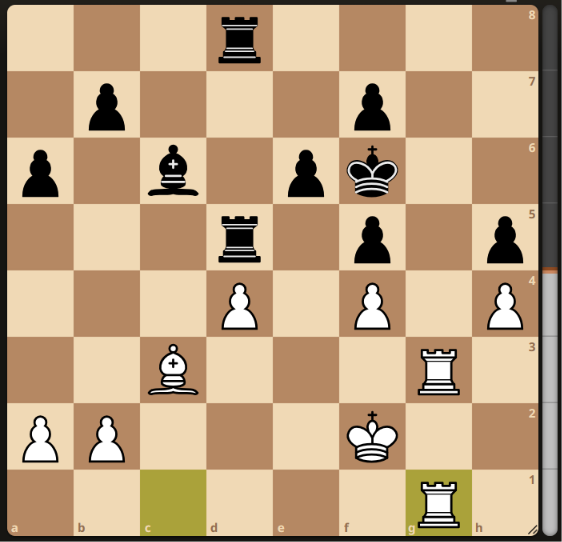 | 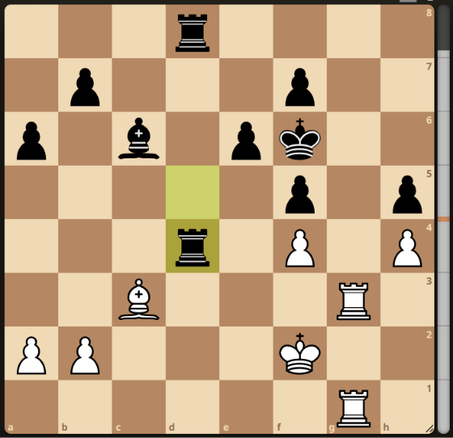 |
|:---:|:---:|
| (a) Before: Black to move, position equal. | (b) After the blunder ...Rxd4??: White to move, +6.0. |

*Figure 8. Example 1 (pin). Black self-pins the rook with ...Rxd4??. The winning replies Rd3 and Rd1 have a combined prior of ~0.12%.*

White plays Rcg1, and the position is, according to Stockfish, equal. Black plays Rxd4??, self-pinning the rook, and giving white a +6.0 advantage. White follows up with Rd3, attacking the pinned piece. Black can only temporarily defend this, as white attacks the pinned piece with both rooks, and black resigns.

After the Rxd4?? blunder, the network evaluates the position as +0.55 pawns from Black's perspective, however, its principal variation follows the line: Rxd4 Rg8 Ke7 Bxd4 Rxd4, completely missing white's best response to attack the pinned rook. The reason becomes clear when analysing the following position after the Rxd4 capture, from White's perspective. Both Rd1 and Rd3, which are winning moves, receive a combined prior probability of ~0.12%.

White's search only finds it because Gumbel noise lifts one of these moves into the 16 candidates. Once the net searches even a small amount, it realises the position is winning, overcoming the very low initial prior. However, because of this low prior, it was not explored by black at all when searching at Rxd4. In this position, by prior, Rd3 ranked 17th, and Rd1 ranked 22nd, out of 31 legal moves. In the game, Rd3 was played, as it was boosted into the top 16 by gumbel noise.

These tactical misses are a known weakness of policy networks. The network gives a very low prior to White moving a rook to a square where it appears it can be captured. Seeing why that's safe requires combining several pieces at once: the white rook looks undefended, but it can't be taken because the white bishop pins the black rook to the black king. The network can see the whole board, so the difficulty isn't range. More likely, positions like this are rare in self-play, and because the search rarely finds the refutation, the network is rarely corrected. Patterns like pins and discovered attacks therefore depend on search to be found.

This particular example does not benefit from a larger search budget, as increasing the search budget eightfold, to 1,024 simulations, did not change Black's choice. Below the root, moves that haven't been visited all look equally good to the search, so it tries them in order of prior. With a prior of just 0.087%, Rd3 sat near the bottom of that order, and Black's search never reached it. Instead, it requires greater exploration at non-root nodes, at the cost of a shallower search at a fixed budget. I did briefly explore adding an exploration term to non-root node selection, however, at 128 simulations, this produced worse game quality than pure deficit based selection.

Because White's search rates a very low-prior move as winning, it will produce a very strong training signal - up to 7.0 nats, or roughly 10 times the average converged policy loss. Ideally these tactical blunders provide enough learning signal for the network to learn to assign higher priors to these types of moves, but I found that did not happen consistently, and tactical blind spots were still relatively common. Additionally, Black's search rated Rxd4 highly, so Black's policy target for that position pushes towards Rxd4. The pre-blunder position reinforces the error while the post-blunder position corrects it. That helps explain why these blind spots persist.

#### Example 2: Discovered attack

| 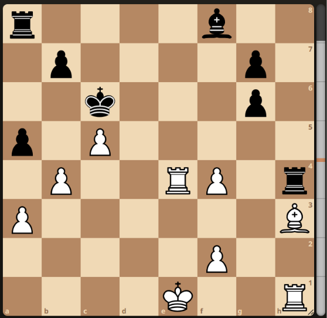 | 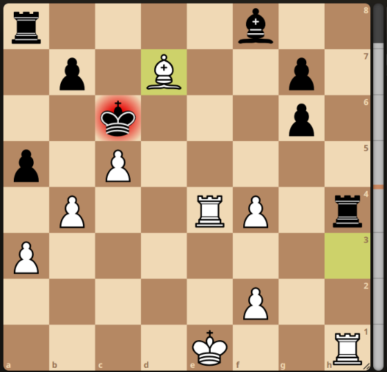 |
|:---:|:---:|
| (a) Before: White to move (+5.6). | (b) The missed move: Bd7+, a discovered attack on the rook on h4. |

*Figure 9. Example 2 (discovered attack). White misses Bd7+, which had a prior of ~0.029% (23rd of 28 moves), outside the m = 16 candidates.*

This second example from a self-play game highlights another limitation with the search, that is, when the best move is not present in the initial m=16 candidate selection. In this position, white has a clear best move - Bd7+, checking the black king, and revealing a discovered attack on the black rook on h4. Stockfish gives this position as +5.6.

In the game, white played Bg2, giving a +1.16 advantage to white. Bd7+ got about 0.029% of the prior, 23rd of 28 legal moves, with a logit of −4.40. It was not allocated visits because it was outside the top 16 moves for sequential halving. With m=32 and n=128, the network does correctly find Bd7+. This is another tactic with a complex piece interaction (king, bishop and both rooks). However, the difference between this and the previous example is that the network does not receive any learning signal.

This failure illustrates an interesting trade off in sequential halving - breadth vs depth at a fixed budget. With m=16, occasionally moves like this will be missed. The network can generalize from other similar positions, and noise can occasionally bump low prior moves into the selection pool, but that process is slower than if those positions are discovered directly through search. The trade off is that at m=32 n=128, the principal variations are not searched as deeply. It is not clear which approach is best. I tested m=8 and found the network never learned queenside castling. Near the beginning of a run, Queenside castling is given a low prior from the network. At m=8, it was not sampled enough, and as the priors sharpened, noise could not overcome the gap, and it was never learned.

### Comparison with existing work

This section compares Talbot v1.0's training cost against other AlphaZero-style projects. The reference point is the final estimate of 3246 Elo on the CCRL Blitz scale (Talbot on an RTX 5060 Ti; opponents on a single CPU core), reached after 95.8 hours of training across ~4.8M self-play games. That corresponds to ~4.8M games × ~80 plies × 128 simulations ≈ 4.9×10¹⁰ network evaluations, × ~0.38 GOPs per 10×128 forward pass ≈ 2×10¹⁹ operations. Each project measures strength differently, against different opponents, hardware and time controls, so this is a slightly crude attempt to compare efficiency across hardware, network sizes and final strength.

| Project | Hardware | Training time | Self-play games | Sims/move | Estimate self-play operations | Strength |
|---|---|---|---|---|---|---|
| Talbot v1.0 | 1xRTX 5060 Ti | 95.8 h | ~4.8M | 128 | ~2x10^19 | 3246 CCRL Blitz (anchored) |
| AlphaZero | 5000x TPU v1 | 9h | ~44M | 800 | ~8x10^21 | 52 Elo over SF8 (not CCRL scale) |
| Leela test10 (net 11248) | Distributed volunteer GPUs | Months | ~50M | 800 | 1x10^22 | 3282 (scale unstated) |
| Efficient Self-Play Chess (2026) | 8x RTX 4070 SUPER | 60hr | ~3.25M | 300-600 (PUCT) | ~8×10^19 | 3251 (vs fixed-node Stockfish 13) |

*Table 8. Training cost and strength of Talbot v1.0 compared with other AlphaZero-style projects.*

#### AlphaZero

AlphaZero's self-play compute is estimated from its published figures [1], assuming an average game length of 80 plies, as for every project in this comparison. Its 44 million self-play games then give about 3.5 × 10⁹ positions. At 800 simulations per move, that is about 2.8 × 10¹² network evaluations. Its 19-block, 256-filter network costs about 3.0 G operations per evaluation, so the total is roughly 8 × 10²¹ self-play operations. Training on 64 second-generation TPUs is excluded, as it adds only a few percent.

#### Leela Chess Zero (test10)

Leela's test10 run trained a 20-block, 256-filter network on games generated by volunteers' GPUs. The run doesn't publish a total game count, but at 40,000 self-play games for each of about 1,260 networks [4], it generated roughly 50 million games. Assuming 80 plies per game, that's about 4.0 × 10⁹ positions. At 800 playouts per move, Leela's standard self-play setting at the time, this gives about 3.2 × 10¹² network evaluations. At about 3.0 G operations per evaluation, the total is roughly 10²² self-play operations, close to AlphaZero's, which used the same network size and simulation count. Its best network, 11248, is listed at 3282 [4], but the scale isn't stated.

#### Engineering Efficient Self-Play Chess (2026)

This recent single-node run [3] trained a 14-block, 160-channel network on one machine with eight RTX 4070 SUPER GPUs over 2.5 days, using PUCT search. It reports approximately 100 billion search simulations. At roughly 0.79 G operations per evaluation for the final 14×160 network, this gives at most about 8 × 10¹⁹ self-play operations, around 3.5–4 times Talbot's.

Additionally, this net trains from self-play without human games, but its inputs include derived features such as check flags and material counts, which AlphaZero-style inputs leave for the network to learn. Talbot does not include these.

#### Other Engines

To my knowledge, Gumbel MCTS has not previously been demonstrated on chess at low simulation counts to a competitive strength. The original work [2] tested chess only at 400 simulations per move, where it matched AlphaZero's performance; its low-simulation experiments, from 2 to 200 simulations, were all on 9×9 Go. Talbot's self-play runs at 128 simulations per move, below anything tested on chess in that work. The main strong open engine, Leela Chess Zero, uses PUCT, as does the 2026 single-node run compared above.

I found no comparable tabula rasa chess engine trained on a single GPU and evaluated against rated engines. Small-scale projects exist, but they typically report no strength figure, or one measured against unspecified opponents. The 2026 single-node run is the nearest published comparison, and it used eight GPUs.

#### Summary

AlphaZero and Leela's test10 run each used roughly 10²² self-play operations. Both reached a much higher level, though, and on hardware and rating scales that make a direct comparison hard. They were also optimising for maximum strength, rather than efficiency. Talbot reaches a strong level with ~400x less self-play compute than the original systems.

The closest comparison is the 2026 single-node run, which used about 3.5-4x the self-play operations. It reports 3251 against fixed-node Stockfish 13, a different scale from the CCRL Blitz estimate used here, so the two strengths are not directly comparable.

## Future work

Talbot v1.0 was an efficiency exercise. The next step is scaling: larger networks, longer runs and a deeper search.

### Training

- Scaling up the network is an obvious choice. I have done preliminary testing with a 15x192 network trained to 100k steps, but this performed 61 Elo below the 10x128 net, which may be due to INT8 quantisation during training, as it had a noticeable detrimental impact during inference. I plan on disabling it and continuing training with FP16.

- The 15x192 run will continue with m = 32 and a larger simulation budget. Gains at this scale have been slow. A wider, deeper search should also address the blind spots shown in the worked examples and produce better training targets.

- Exploring KataGo-style [5] surprise weighting, which samples each training position in proportion to the KL divergence between the search's policy target and the network's prior. Positions where search found something the network missed, like the tactics in the worked examples, are trained on more often, so the network learns from its biggest mistakes faster, at no extra self-play cost.

### Inference

- At inference time, each game currently runs a single search thread, and the UCI search is CPU bottlenecked. Running several threads on one shared tree would make better use of the GPU, but requires careful implementation.

- Systematic tuning of the PUCT exploration constant, including making it grow with visit count so the search widens as it deepens, and of the value assigned to unvisited moves.

## References

1. D. Silver et al. *A general reinforcement learning algorithm that masters chess, shogi, and Go through self-play.* Science 362(6419), 2018.
2. I. Danihelka, A. Guez, J. Schrittwieser, D. Silver. *Policy improvement by planning with Gumbel.* ICLR 2022.
3. B. Braun. *Engineering Efficient Self-Play Chess: Search, Replay, and Throughput Under Limited Compute.* arXiv:2609.37447, 2026. Code: <https://github.com/BertilBraun/alphazero-chess>
4. Leela Chess Zero. *Training runs* (test10). <https://lczero.org/dev/wiki/training-runs/>
5. D. J. Wu. *Accelerating Self-Play Learning in Go* (KataGo). arXiv:1902.10565, 2019.
6. K. He, X. Zhang, S. Ren, J. Sun. *Deep Residual Learning for Image Recognition.* CVPR 2016.
7. J. Hu, L. Shen, G. Sun. *Squeeze-and-Excitation Networks.* CVPR 2018.
8. CCRL Blitz rating list. <https://computerchess.org.uk/ccrl/404/>
9. Ordo rating tool. <https://github.com/michiguel/Ordo>
10. fastchess. <https://github.com/Disservin/fastchess>
11. Stockfish opening books (8moves_v3). <https://github.com/official-stockfish/books>